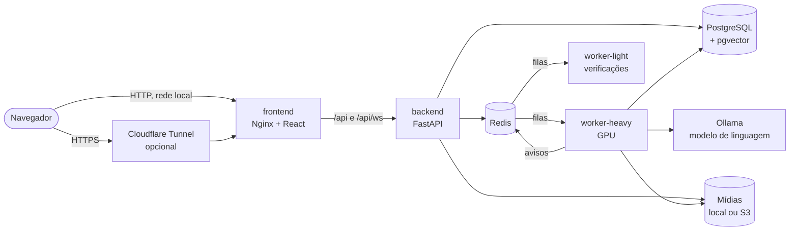
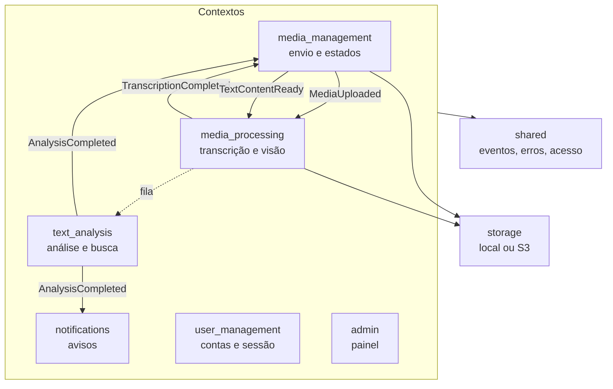
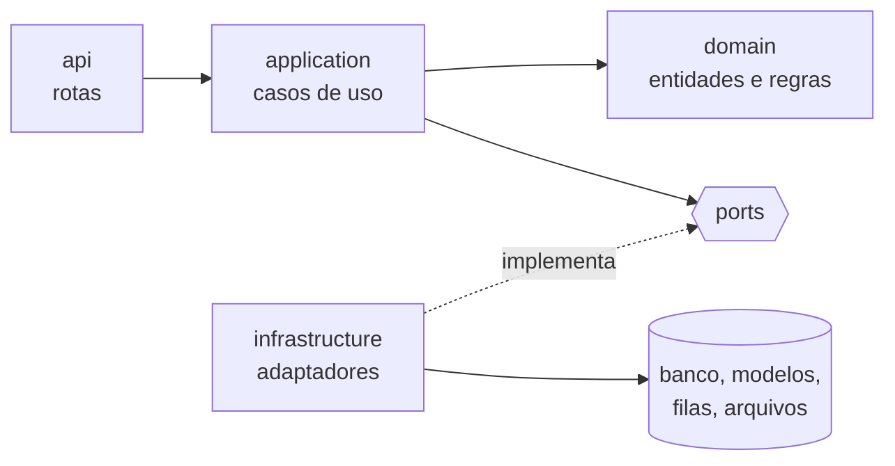

# Arquitetura

O sistema é um **monólito modular**: um só repositório e uma só imagem, mas
dividido em módulos com fronteiras verificadas, cada um com o próprio domínio
e as próprias tabelas. Dentro de cada módulo, as camadas seguem a arquitetura
hexagonal (portas e adaptadores). Esta página explica essa organização e por
que ela foi escolhida.

## Visão geral

| Processo | Papel |
|---|---|
| `frontend` | Serve a interface e encaminha `/api` ao backend (Nginx) |
| `backend` | API: recebe envios, consultas e revisões. **Não roda os modelos da análise**: os pedidos vão para a fila |
| `worker-heavy` | Uma tarefa por vez, na GPU: transcrição, descrição dos quadros, extração de texto e análise |
| `worker-light` | Verificações periódicas, que recuperam o que ficou parado |
| `ollama` | Serve o modelo de linguagem, carregado sob demanda |
| `postgres`, `redis` | Dados e vetores; filas, avisos em tempo real e tokens revogados |

A API e os workers usam a **mesma imagem**, com comandos diferentes (ADR-009).
Separar o recebimento do processamento impede que uma falta de memória da GPU
derrube a API, e permite acrescentar workers sem mudar a API.

## Módulos

As setas cheias são **eventos de integração**; a pontilhada é a fila do Celery.
A lista completa de eventos, com quem publica e quem reage, está na
[referência de eventos e filas](../referencia/eventos-e-filas.md).

Quatro regras mantêm os módulos independentes, e cada uma é conferida por um
teste ou pelo `lint-imports`:

- **Cada módulo consulta só as próprias tabelas.** Para saber de dados de
  outro, ele declara uma porta e deixa o outro módulo implementá-la.
- **Cada evento tem um único publicador** (`published_by`), e os campos são
  tipados: quem reage sabe exatamente o que recebe.
- **O núcleo compartilhado (`shared`) é pequeno.** A aplicação e o domínio
  importam só `shared.domain` e `shared.application`, nunca a
  infraestrutura.
- **Fronteiras de importação** declaradas em `.importlinter`: por exemplo,
  `media_processing` e `text_analysis` não importam `notifications`.

## Camadas dentro de um módulo

- O **domínio** guarda as regras: uma mídia só muda de estado pelos métodos
  da entidade, que recusam transições fora de ordem.
- A **aplicação** coordena os casos de uso e fala com o mundo só por
  **portas**. Trocar o Whisper, o modelo de linguagem ou o armazenamento é
  escrever outro adaptador, sem tocar no caso de uso.
- A **composição** acontece num lugar só: cada serviço tem uma fábrica em
  `infrastructure/dependencies/builders.py`, usada pela API, pelos workers e
  pelas reações a eventos (ADR-001). Não há objetos globais, exceto os modelos
  carregados e o barramento de cada processo de worker.

## Eventos dentro e entre processos

O barramento de eventos é **em memória, por processo** (ADR-010). Dentro da
API ou de um worker, um evento chega às reações inscritas na hora. Entre
processos, o trabalho segue pelas **filas do Celery** e os avisos ao usuário
pelo **Redis**. Um evento perdido numa queda é recuperado pelas verificações
periódicas, que reconstroem o estado a partir do banco.

Um barramento distribuído (Kafka, por exemplo) acrescentaria um serviço e
garantias de entrega que, com uma máquina e um volume pequeno de eventos, as
verificações periódicas já cobrem. A troca fica para quando houver mais de uma
máquina, com uma tabela de saída (*outbox*).

## Por que um monólito modular

| Alternativa | Por que não, por enquanto |
|---|---|
| Microsserviços | Uma máquina, uma equipe e uma GPU: cada serviço a mais traria rede, versões e implantações sem ganho de escala |
| Monólito sem módulos | As regras de mídia, análise e conta se misturariam; trocar um modelo exigiria mexer em vários lugares |

Os módulos já conversam por eventos e portas. Se um deles precisar escalar
sozinho (mais workers de análise, por exemplo), ele pode sair para um processo
próprio sem reescrever os outros.

## Veja também

- [Pipeline de processamento](pipeline.md): os eventos em ação, do envio ao
  resumo.
- [Estrutura do repositório](../referencia/estrutura.md): onde fica cada
  módulo e cada camada.
- [Decisões de arquitetura](../adr/decisions.md): ADR-001, 009 e 010.
