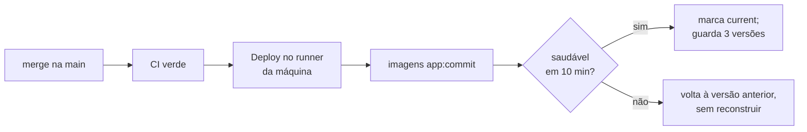

# Operação e confiabilidade

Como o sistema chega à produção, como se sabe que está saudável e como se
recupera de uma falha, numa única máquina sem equipe de plantão. Os passos
práticos estão nos guias; aqui ficam os motivos. Decisões: ADRs 016, 017 e 018.

## Uma máquina, um Compose

A produção é um Docker Compose de nó único: um arquivo descreve todos os
serviços, com versões fixas, verificações de saúde e reinício automático.
O Kubernetes acrescentaria um plano de controle e a configuração das GPUs sem
benefício enquanto houver uma máquina só.

O preço é depender do **Docker Desktop**, que roda na sessão do usuário do
Windows: o runner também precisa rodar nela, e o Docker precisa ser aberto no
logon. O caminho natural de evolução é o Docker Engine direto no WSL ou num
servidor Linux, com os mesmos arquivos do Compose.

## Implantação contínua com volta automática

- **O runner fica na própria máquina.** A alternativa usual, o GitHub acessar o
  servidor por SSH, exigiria uma porta aberta e uma chave do servidor guardada
  no GitHub, e não funcionaria atrás do NAT da operadora.
- **Imagens marcadas pelo commit.** As versões anteriores ficam na máquina, e
  voltar a uma delas leva segundos, sem internet e sem reconstruir.
- **Sem registro de imagens.** A imagem do backend, com as bibliotecas da GPU,
  ocupa 13 GB, acima da cota de pacotes de um repositório privado no plano
  gratuito; a CI constrói e varre a variante de CPU, que tem as mesmas camadas
  de sistema.
- **Migrações num serviço próprio**, que roda uma vez antes da API e dos
  workers. Uma migração precisa ser compatível com a versão anterior
  (expandir, e só depois contrair), ou a volta automática não funciona.

## Saber se está saudável

| Sinal | Onde |
|---|---|
| Saúde de cada contêiner | `docker compose ps`: a API consulta o banco e o Redis; os workers respondem pelo próprio Celery, mesmo no meio de uma transcrição longa |
| Logs estruturados | JSON, com o identificador de correlação do pedido até a tarefa do worker; rotação de 5 arquivos de 20 MB por contêiner |
| Métricas | Prometheus, coletadas da API e dos workers numa porta interna, nunca pela API pública |
| Rastros | Jaeger (OpenTelemetry): o caminho de uma requisição e das tarefas que ela gerou |
| Visão do administrador | Fila de processamento (com as mídias paradas marcadas), servidor (CPU, memória, GPU) e qualidade das análises |

O identificador de correlação nasce na requisição, viaja no evento
`MediaUploaded` e aparece em todos os logs dos workers daquela mídia: um único
valor reconstrói a história inteira de um envio.

## Recuperar-se de falhas

| Falha | Recuperação |
|---|---|
| Contêiner cai | `restart: unless-stopped` o sobe de novo |
| Máquina reinicia | No logon, a tarefa abre o Docker Desktop e o runner; os contêineres voltam sozinhos |
| Runner para | A tarefa confere a cada 5 minutos e o inicia de novo |
| Worker interrompido no meio de uma mídia | As verificações periódicas dão a mídia como falha, com o motivo ([Pipeline](pipeline.md#quando-algo-falha)) |
| Versão nova não fica saudável | O deploy volta à anterior |
| Perda de dados | Cópia diária com restic, testada toda semana por uma restauração real |

### Cópias de segurança testadas

Uma cópia que nunca foi restaurada não é confiável. Aos domingos, o banco mais
recente é restaurado num PostgreSQL temporário e conferido por consultas, e
parte dos dados do repositório é lida de volta. Foi um teste de restauração
completo, com perda simulada, que mostrou que o script antigo restaurava o
banco e deixava as mídias para trás (corrigido em outubro de 2026).

## Limites conhecidos

- **Cópia fora da máquina**: o repositório do restic fica na mesma máquina, e a
  regra 3-2-1 não é cumprida. O próximo passo é um repositório remoto, num
  serviço compatível com S3.
- **Alertas**: o Prometheus coleta as métricas, mas nada avisa quando um worker
  cai, a fila não anda ou o disco enche. O próximo passo é o Alertmanager com
  essas regras.
- **Dependência da sessão do Windows**: resolvida pelo Docker Engine no WSL ou
  num servidor Linux.
- **Nó único**: sem redundância de máquina; uma falha de hardware para o
  sistema até a restauração numa outra máquina.

## Veja também

- [Implantar em produção](../guias/implantar-em-producao.md) e
  [Cópias de segurança](../guias/copias-de-seguranca.md): os passos.
- [Solucionar problemas](../guias/solucionar-problemas.md): os incidentes já
  vistos.
