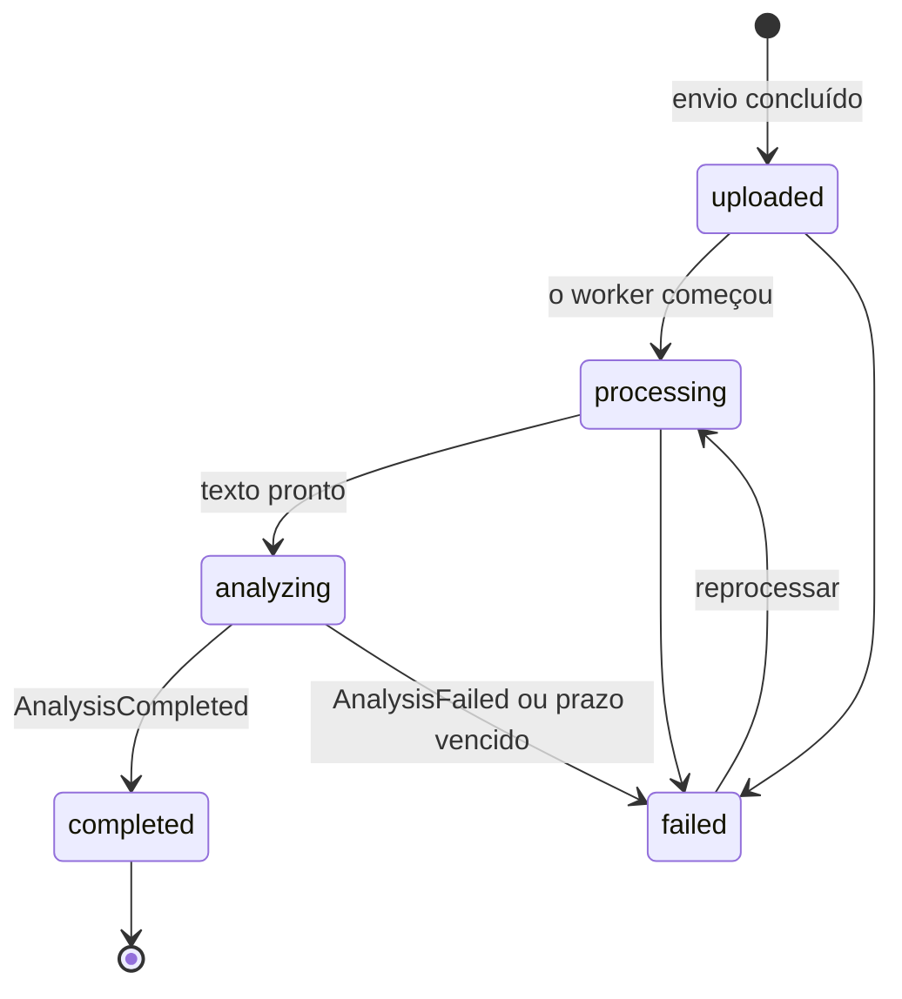
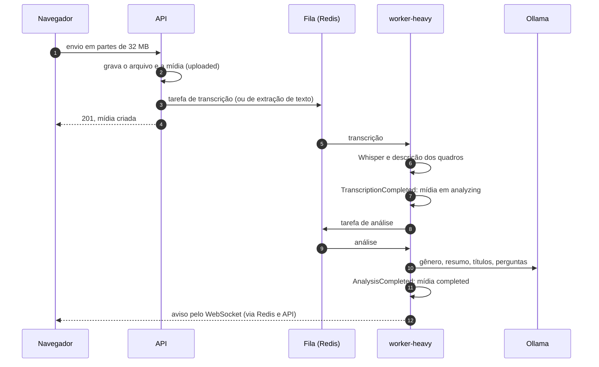

# Pipeline de processamento

O caminho de uma mídia, do envio ao resumo: quem faz cada parte, como as
partes se avisam e o que acontece quando algo falha no meio. Para os modelos
de cada etapa, veja a [referência dos modelos](../referencia/modelos.md).

## Estados de uma mídia

As transições vivem na entidade `Media`. Um evento fora de ordem, como uma
transcrição concluída depois de a mídia ter falhado, é recusado pela entidade
e ignorado. A mídia só fica `completed` quando a análise anuncia o fim.

## Do envio ao resumo

1. **Envio.** A interface manda o arquivo em partes de 32 MB, porque a
   Cloudflare recusa requisições acima de 100 MB. Ao concluir, a API grava a
   mídia e publica `MediaUploaded` no próprio processo.
2. **Agendamento.** Ainda na API, o módulo de processamento reage ao evento e
   põe a tarefa na fila: **transcrição** para áudio e vídeo, **extração de
   texto** (com OCR) para documentos e imagens. Arquivos com menos de 50 MB
   vão para uma fila rápida, à frente dos grandes.
3. **Transcrição.** O worker pesado baixa o arquivo para o disco, transcreve
   com o Whisper e, nos vídeos, descreve uma amostra de quadros, guardando uma
   descrição por cena. Ao terminar, publica `TranscriptionCompleted`; a mídia
   passa a `analyzing`, e o módulo de mídias publica `TextContentReady`.
4. **Pedido da análise.** O módulo de processamento reage a `TextContentReady`
   pondo a tarefa de análise na fila, pelo nome, sem importar o módulo da
   análise.
5. **Análise.** Etapa por etapa, com o resultado parcial salvo ao fim de cada
   uma (ADR-002):

   | Etapa | Opcional |
   |---|---|
   | Divisão em trechos e vetores (e5) | não |
   | Sentimento | `sentiment` |
   | Temas (BERTopic) e seus títulos | `topics` |
   | Indexação para a busca (pgvector) | não |
   | Gênero do conteúdo | não |
   | Resumo, guiado pelo gênero | não |
   | Capítulos (cortes pelos temas, títulos pelo modelo) | `chapters` |
   | Perguntas de revisão (cada uma aponta um capítulo) | `questions` |
   | Verificação de fidelidade | `grounding` |

   Nos capítulos e nas perguntas, **o modelo escreve e os dados decidem**: os
   cortes vêm dos temas, e o horário de cada pergunta vem do capítulo que ela
   cita (ADR-013).
6. **Fim.** A análise publica `AnalysisCompleted`. A mídia fica `completed`, e
   o módulo de avisos grava o aviso e o publica no Redis; a API o entrega ao
   navegador pelo WebSocket.

## Quando algo falha

| Falha | O que acontece |
|---|---|
| Erro passageiro (rede, modelo ocupado) | A tarefa é repetida, até 3 vezes |
| Erro permanente (arquivo inválido, gravação sem fala) | A mídia falha na hora, com o motivo, sem novas tentativas |
| Modelo principal de linguagem indisponível | O reserva entra; sem os dois, o resumo vira o simplificado (temas e palavras-chave), marcado como tal |
| Etapa opcional falha | É registrada como falha e a análise segue; uma etapa obrigatória falha a análise |
| Worker interrompido no meio | As verificações periódicas dão a mídia como falha depois do prazo, com o motivo |

Nenhum adaptador inventa resultado quando o modelo não carregou: ele gera erro,
e a etapa aparece como falha. Antes, vetores de mentira faziam a busca devolver
trechos aleatórios sem ninguém perceber.

### Verificações periódicas

O `worker-light` roda duas verificações a cada 5 minutos:

- **Envios que não começaram**: mídias em `uploaded` há mais de 10 minutos são
  reenviadas à fila; depois de 60 minutos, dadas como falha.
- **Processamento parado**: o prazo de cada mídia é calculado pela duração da
  gravação e pela velocidade medida nos processamentos anteriores (com folga
  de 3 vezes, entre 20 minutos e 6 horas).

Uma análise parada há mais de 180 minutos é dada como falha. Antes disso, a
recuperação confere se a análise já terminou e só o anúncio se perdeu: nesse
caso, a mídia é concluída em vez de falhar.

### Revisão humana preservada

Correções do resumo, dos títulos dos temas, dos capítulos e das perguntas
guardam a versão da IA. Uma nova análise não sobrescreve o que já foi revisado:
a API recusa o pedido com 409, e o worker confere a mesma regra antes de gravar
(ADR-015). As correções da transcrição ficam e alimentam a análise seguinte.

## Veja também

- [Arquitetura](arquitetura.md): módulos, eventos e filas.
- [Referência de eventos e filas](../referencia/eventos-e-filas.md).
- [Modelos e etapas da análise](../guias/modelos-e-etapas.md): ligar e
  desligar as etapas opcionais.
